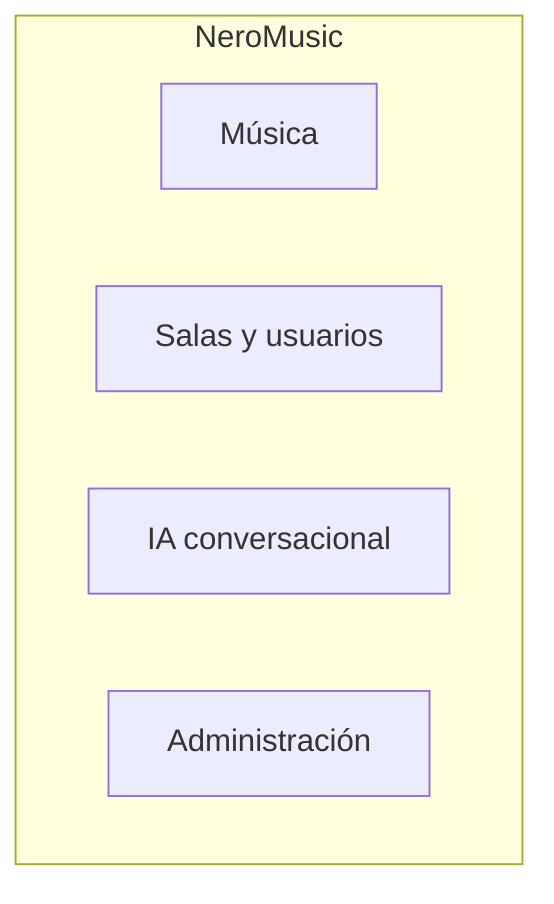

# Diagrama de áreas funcionales

Vista conceptual de NeroMusic como producto. Muestra únicamente sus grandes áreas funcionales.

No incluye relaciones, dependencias ni detalles de implementación.

## Lectura del diagrama

- **Música:** reproducción, búsqueda, listas y control dentro de la sala.
- **Salas y usuarios:** operación de las comunidades y su administración.
- **IA conversacional:** conversación y personalidades configurables.
- **Administración:** gestión del servicio, de las salas y de los clientes.

Las áreas son funcionales, no componentes técnicos. El diagrama no representa cómo se conectan ni cómo se implementan.

La versión editable está en [`architecture.mmd`](architecture.mmd).
